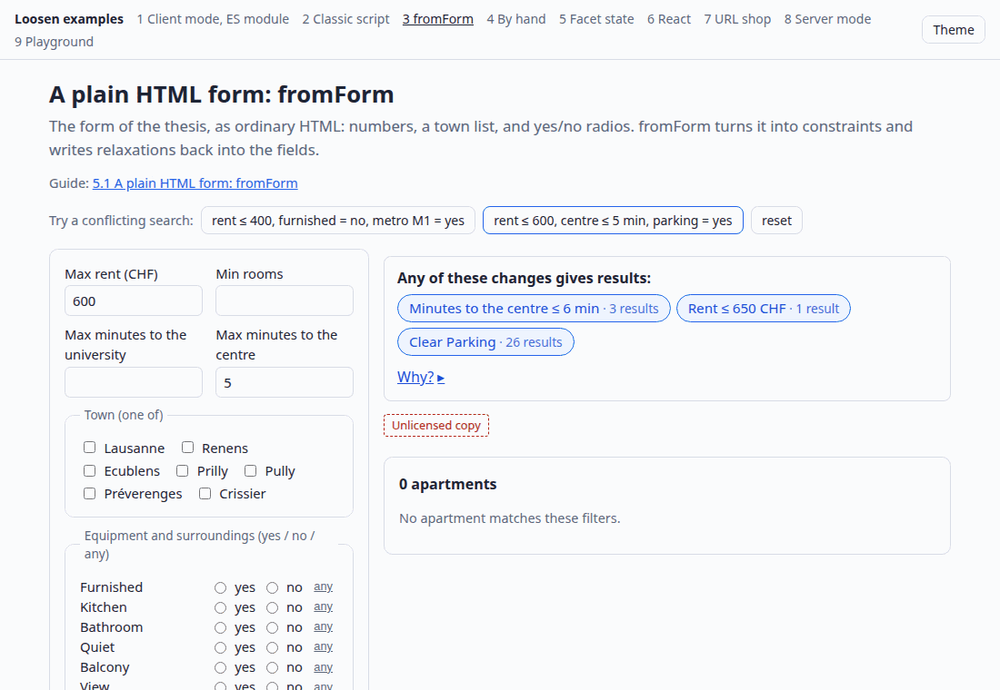
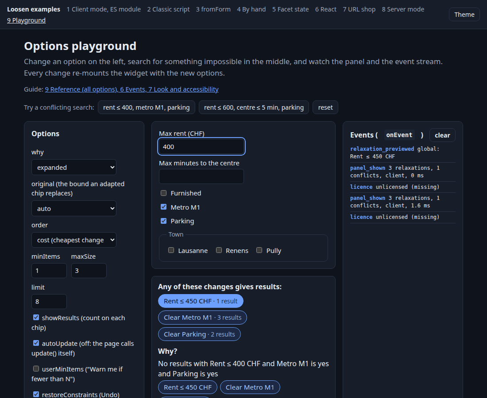

# Loosen examples

[](https://loosen.sicena.com/demo/) **[Try every variant live: loosen.sicena.com/demo/](https://loosen.sicena.com/demo/)** (the same pages as here, with a real `loosend` for server mode; nothing to install).

Runnable examples of every way to integrate [Loosen](https://loosen.sicena.com), on one real catalogue: **186 apartments in the Lausanne area**.

Loosen explains empty search results. When a visitor's filters return nothing, the widget shows which filters conflict and what to
relax ("Rent ≤ 706 CHF · 1 result", "Clear Features · 6 results"), and applies the change to *your* filters with one click, with Undo.
It is one script and a few lines of glue; the analysis runs in the browser or on your own server (`loosend`).





## The variants

Open <https://loosen.sicena.com/demo/> (hosted) or `http://localhost:8123/` after `./serve.sh`. Every page has buttons for two searches that find nothing, a collapsible
**Source** block with the exact integration code, and a link to the matching guide section.

| # | Variant | Page | Live | Guide section |
|---|---|---|---|---|
| 1 | Client mode, ES module (`mount`; data as array, URL, async function) | `examples/client-module.html` | [Live](https://loosen.sicena.com/demo/examples/client-module.html) | [2](https://loosen.sicena.com/docs/install#script), [4](https://loosen.sicena.com/docs/install#data) |
| 2 | Classic `<script>` (`window.Loosen`) | `examples/classic-script.html` | [Live](https://loosen.sicena.com/demo/examples/classic-script.html) | [2](https://loosen.sicena.com/docs/install#script) |
| 3 | Plain HTML form with `fromForm` (the thesis form) | `examples/form-fromform.html` | [Live](https://loosen.sicena.com/demo/examples/form-fromform.html) | [5.1](https://loosen.sicena.com/docs/install#form) |
| 4 | By hand: `getConstraints`, `applyRelaxation`, `restoreConstraints`, `onPreview` | `examples/by-hand.html` | [Live](https://loosen.sicena.com/demo/examples/by-hand.html) | [5.2](https://loosen.sicena.com/docs/install#manual) |
| 5 | Facet state object (Algolia / Typesense / Meilisearch style) | `examples/facets-state.html` | [Live](https://loosen.sicena.com/demo/examples/facets-state.html) | [5.3](https://loosen.sicena.com/docs/install#facets) |
| 6 | React 18 (vendored UMD, no JSX, no build) | `examples/react.html` | [Live](https://loosen.sicena.com/demo/examples/react.html) | [5.4](https://loosen.sicena.com/docs/install#react) |
| 7 | Server-rendered shop, filters in the URL (Go, stdlib only) | `cmd/shop`, <http://localhost:8124/> | [Live](https://loosen.sicena.com/demo/shop/) | [5.5](https://loosen.sicena.com/docs/install#url) |
| 8 | Server mode with `loosend` (read key, CORS, `curl` loading) | `examples/server.html` | [Live](https://loosen.sicena.com/demo/examples/server.html) | [4](https://loosen.sicena.com/docs/install#data), [server docs](https://loosen.sicena.com/docs/server) |
| 9 | Options playground (all options, events, theming, texts, keyboard) | `examples/playground.html` | [Live](https://loosen.sicena.com/demo/examples/playground.html) | [6](https://loosen.sicena.com/docs/install#events), [7](https://loosen.sicena.com/docs/install#look), [9](https://loosen.sicena.com/docs/install#reference) |

The React page runs the recipe of section 5.4 in real React 18 (tested with Playwright, including Undo). Running it found a bug in the recipe as printed; it is fixed in the guide and the page uses the fixed version.

## Run it

Requirements: `python3` **or** Go (1.22+) for the static server. Docker is optional (loosend and the compose file). Nothing to install, nothing to build.

```sh
./serve.sh                 # the static examples (variants 1 to 6 and 9) on http://localhost:8123/
./serve.sh --with-server   # also: the shop on :8124 and loosend on :8130 with the catalogue loaded (variants 7 and 8)
./serve.sh --stop          # stop what was started   (DETACH=1 ./serve.sh ... runs in the background)
docker compose up          # the same three servers in containers, loosend loads data/apartments.csv with its feed
```

| Port | What | Started by |
|---|---|---|
| 8123 | the static examples (`scripts/static_server.py`, or `cmd/shop -landing` when there is no python3) | `./serve.sh` |
| 8124 | the server-rendered shop (`cmd/shop`) | `./serve.sh --with-server` |
| 8130 | `loosend`, the Loosen server | `./serve.sh --with-server` (`scripts/run-loosend.sh`) |

`PORT=9000 ./serve.sh` changes the first one; `LOOSEND_PORT`, `SHOP_PORT` the others (then adjust `config.js`, `LOOSEND_SHOP` / `LOOSEND_SERVER`).

### Server mode step by step (variant 8)

```sh
scripts/run-loosend.sh      # the public image ghcr.io/sicena-com/loosend:1.0.0 if Docker works, else the Linux/macOS binary from
                            # https://loosen.sicena.com/downloads, whose SHA-256 is checked against SHA256SUMS before it runs
scripts/load-catalog.sh     # curl: PUT the schema, PUT the 186 items (data/apartments.loosend.json), PUT the read key
open http://localhost:8123/examples/server.html
```

CORS: `LOOSEND_ALLOWED_ORIGINS` must contain the origin of the page (`run-loosend.sh` sets it from `PAGE_ORIGIN`). The read key (`examples-read-key`) is
sent by the widget in `X-Loosen-Key`; it is in the page's source, so it is not a secret. The admin key (`examples-admin-key-0000`) is for this local
example only and never reaches a browser. `docker-compose.yml` shows the other way to fill a catalogue: a **feed** (`server/loosend.feed.json` points at `data/apartments.csv`).

## Licence keys: what the widget does here

The examples run **unlicensed**. That works: the widget analyses, explains and applies changes, shows a small *Unlicensed copy* note under the panel, writes
one warning to the console, and limits client mode to 1,000 items (186 fit). On `localhost`, `127.0.0.1` and `*.local` the **domain** check of a licence always
passes, but a licence key is still needed to remove the note: without one, localhost behaves exactly like any other host (note, warning, 1,000 items). Checked in
`widget/src/licence.js` and in the browser (the test below asserts the note and the licence event).

To see the pages without the note, get a free 30-day trial key at <https://loosen.sicena.com/trial> and paste it into `config.js`:

```sh
cp config.example.js config.js     # serve.sh does this for you; config.js is git-ignored
# edit config.js:  window.LOOSEN_LICENCE = "LSN1.eyJ...";
```

Every page reads `window.LOOSEN_LICENCE` from it. (I could not test a real trial key from here; the test only proves that the value of `config.js` reaches the widget.)
For `loosend` set `LOOSEND_LICENCE` in the environment; without it the server runs in evaluation mode (1,000 items).

## The hosted demo

<https://loosen.sicena.com/demo/> is this repository, deployed: the static pages, the shop at `/demo/shop/` and a real `loosend` 1.0.0 (SHA-256 verified) behind
`/demo/api/` (the only public route is `POST /demo/api/v1/catalogs/apartments/explain`; no admin route, no `/health` of loosend, no data directory is reachable).
The pages use relative URLs, so they work at `/` here and at `/demo/` there. It has a production licence key for the host `loosen.sicena.com`, injected through
`config.js` at deploy time only. How it is built and run: [`deploy/README.md`](deploy/README.md).

## Tests

```sh
DETACH=1 ./serve.sh --with-server
NODE_PATH=/path/to/node_modules node test/smoke.mjs      # a node_modules folder that contains `playwright`, with a Chromium installed
```

`test/smoke.mjs` (Playwright, Chromium) loads every page and fails on a console error, page error or failed request; for each variant it searches something impossible,
checks the panel, the chips and their result counts, clicks a chip and checks that the filters, the list and the URL (shop) changed, uses Undo (or Back in the shop),
checks the hover highlight, the keyboard flow (Enter on a chip, focus on Undo, Enter again), the server mode against the real `loosend` (including a wrong read key),
and every option of the playground. 119 checks. Set `BASE`, `SHOP`, `LOOSEND` to test other addresses.

The same test runs against the hosted demo (138 checks: it also asserts that the licence removes the *Unlicensed copy* note, that `loosend` is only reached through
`/api/`, that admin and private routes are refused, that HEAD equals GET and that every response is `Cache-Control: no-cache`):

```sh
BASE_URL=https://loosen.sicena.com/demo NODE_PATH=/path/to/node_modules node test/smoke.mjs
```

## How the data was made

`data/apartments.json` is the catalogue of a thesis experiment: apartment ads collected in 2004, joined with travel times. Only anonymous attributes are published
(rent, rooms, travel minutes, locality, yes/no equipment); no addresses, remarks, dates or source ids. `scripts/gen-apartments` rebuilds it from the two private SQL
dumps (not in this repository). Details and the field dictionary: [`data/README.md`](data/README.md).

## Files

```
index.html               landing page
examples/                the pages 1-6, 8, 9
cmd/shop/                the server-rendered shop (7) and, with -landing, a static server
cmd/front/               the hosted demo's public front: static allow-list, /shop/, only the explain call of loosend (deploy/)
deploy/                  systemd units, build.sh, remote-setup.sh and README of the hosted demo; config/ holds its (SOPS) configuration
assets/                  examples.css, chrome.js (header, Source block), attributes.js (the attribute declaration), results.js (the host's own search)
data/                    the catalogue (json, csv, loosend items) and its README
vendor/                  the Loosen widget (mjs and iife), React 18; SOURCE.txt, LICENSES/
scripts/                 sync-widget.sh, run-loosend.sh, load-catalog.sh, static_server.py, gen-apartments/
server/loosend.feed.json loosend configuration with a CSV feed (used by docker compose)
test/smoke.mjs           the Playwright test
serve.sh, docker-compose.yml, config.example.js
```

Refresh the widget with `scripts/sync-widget.sh` (downloads the published files and writes `vendor/SOURCE.txt` with the SHA-384 hashes; `--from DIR` copies from a local build).

## Troubleshooting

| Symptom | Fix |
|---|---|
| "Unlicensed copy" under the panel | Expected without a key: see [Licence keys](#licence-keys-what-the-widget-does-here). |
| `port 8123 already serves something` | `./serve.sh --stop`, or `PORT=9000 ./serve.sh`. |
| Page 8 says "No loosend answers" | `./serve.sh --with-server`. A 403 `origin_not_allowed` means the page's origin is not in `LOOSEND_ALLOWED_ORIGINS`; 401/403 read key: `?key=` or `READ_KEY` do not match. |
| `run-loosend.sh` without Docker | It downloads the binary and refuses to run it on a SHA-256 mismatch. Windows: download by hand from the downloads page. |
| Blank page, module errors | Open the pages through `http://localhost:8123/`, not `file://` (browsers block module imports and `fetch` from files). |
| Shop (7) says connection refused | It starts with `--with-server` only; the landing link goes to port 8124. |
| Dark page, unreadable panel | The widget inherits only text colour from your page; set `--loosen-bg` and friends (see `assets/examples.css`). |

## Notes on the guide

Found while building these examples. Items 1 and 2 are fixed in the guide (and in the docs of `loosend`); they are kept here as the reason for the code in the pages:

1. **5.4 React: Undo disappeared** because `setFilters` is asynchronous: the new filters are written into the ref (`latest.current = next`) before `setFilters(next)`, in both `applyRelaxation` and `restoreConstraints`.
2. **5.1 `fromForm` with a radio group.** A radio with value `""` is read as `0`, and radio values are strings unless the spec says `number: true`. These examples use yes/no radios with `number: true` and a small "any" button that unchecks them.
3. The widget on a dark page needs `--loosen-bg`, `--loosen-border`, `--loosen-chip-*` (it inherits the text colour, but its background stays white).

## Licence

The example code is MIT ([LICENSE](LICENSE)). `vendor/loosen.*` is the Loosen widget under [Loosen's terms](https://loosen.sicena.com/terms); `vendor/react*` is MIT; see [NOTICE](NOTICE).

## Links and contact

[Install guide](https://loosen.sicena.com/docs/install) · [Server docs](https://loosen.sicena.com/docs/server) · [Downloads](https://loosen.sicena.com/downloads) · [Free trial](https://loosen.sicena.com/trial) · [Contact](https://loosen.sicena.com/contact)
